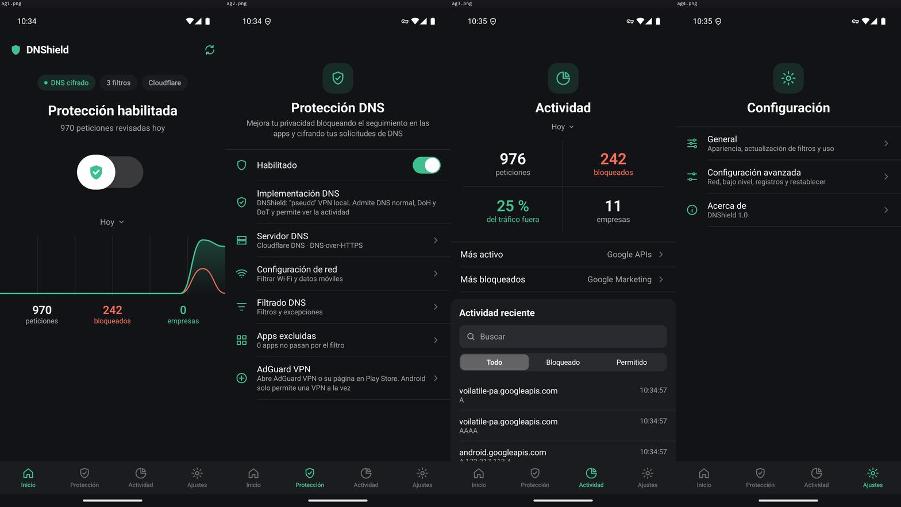

# DNShield

Bloqueador de anuncios y rastreadores para Android, a nivel de DNS, gratis. Funciona como AdGuard en
modo DNS: una "VPN" local que solo intercepta las consultas DNS del móvil. El resto del tráfico va directo,
así que apenas gasta batería.

## Instalar en el móvil

1. Pasa `DNShield.apk` al móvil (cable, Drive, WhatsApp a ti mismo...).
2. Ábrelo desde el móvil. Android pedirá permiso para "instalar apps desconocidas" desde esa app: acéptalo solo para esta vez.
3. Abre DNShield y toca el interruptor grande. Android preguntará si permites la conexión VPN: **Aceptar**.
4. Listo: el interruptor se pone verde y empiezan a contar las peticiones bloqueadas.

## Para que funcione siempre

- **VPN siempre activa:** Ajustes de DNShield › VPN siempre activa › activar para DNShield. Así Android la mantiene encendida.
- **DNS privado:** Ajustes de Android › Red › DNS privado en **Automático** o **Desactivado**. Si pone un servidor, Android se salta el filtro.
- **Chrome:** Ajustes › Privacidad y seguridad › Usar DNS seguro: **desactivado**.

## Qué tiene

| Pestaña | Qué hay |
|---|---|
| Inicio | Interruptor, % bloqueado, gráfica y cifras por periodo |
| Protección | Protección DNS (servidor: Cloudflare, AdGuard, Quad9, Google, OpenDNS, CleanBrowsing, Control D, Mullvad, DNS.SB… en DNS normal, DoH o DoT, más los tuyos; filtrar Wi-Fi/datos), Bloqueo de anuncios (66 listas públicas por categoría, reglas con sintaxis AdGuard, lista de permitido), Protección avanzada (malware y phishing, IPv6, apps excluidas, pausa) y acceso a AdGuard VPN |
| Actividad | Cada dominio pedido con su respuesta, buscador, empresas que más rastrean, ficha con bloquear/permitir en un toque |
| Ajustes | Tema, actualización de listas, pausa, opciones de bajo nivel (modo de bloqueo, IPv6, TTL, bootstrap, servidores alternativos), exportar registros, restablecer |

## Lo que un filtro DNS no puede hacer

- Los anuncios de la **app de YouTube** vienen del mismo dominio que los vídeos: no se pueden quitar por DNS (AdGuard tampoco puede sin root).
- Android solo permite **una VPN a la vez**: si se activa AdGuard VPN u otra, DNShield se para.

## Probado

- **Bloqueo real** en emulador Android 15: anuncios y rastreadores bloqueados, webs normales resuelven, reglas propias al instante, DoH y DoT.
- **En Chrome** ([adblock.turtlecute.org](https://adblock.turtlecute.org/)): 7 % bloqueado sin DNShield, **80 %** con DNShield.
- **Consumo** (APK release): 0,4 s de CPU en reposo cada 2 min, ~1,2 ms por consulta, ~41 MB de memoria, sin wakelocks.
- **Seguridad**: respuestas DNS falsificadas, paquetes corruptos, inundación desde otra app, certificados TLS falsos o caducados,
  componentes exportados, datos privados y que la VPN solo vea el DNS. Ver `tools/security-test.mjs` y `SecurityTest.kt`.

## Desarrollo

- Compilar: `gradlew assembleRelease` (JDK 17 y SDK en `C:\Android`).
- Puertas de calidad en `GATES.md`; scripts en `tools/` (`run-unit-tests`, `check-apk`, `device-dns-test`, `measure-consumption`, `security-test`).
- Fuentes de datos: HostlistsRegistry y companiesdb de AdGuard (públicos).

## Licencia

GPL-3.0 (ver `LICENSE`). Incluye datos públicos de AdGuard bajo GPL-3.0 y CC BY-SA 4.0: detalles en `NOTICE.md`.
Proyecto personal sin ánimo de lucro, no afiliado a AdGuard.
